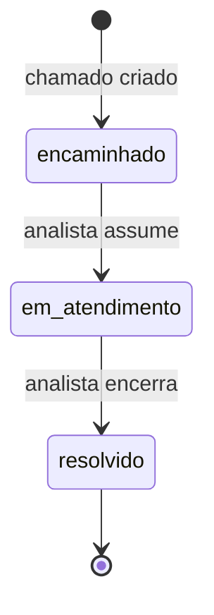
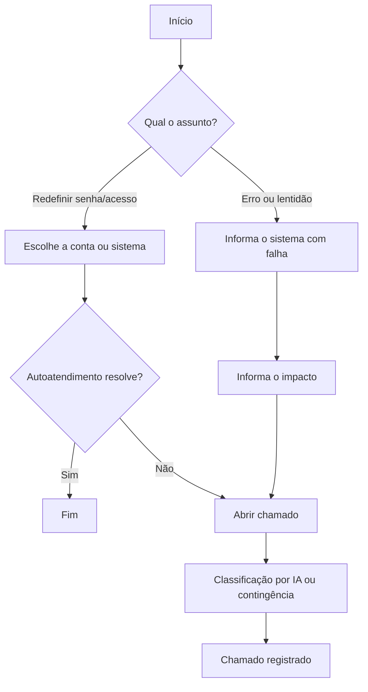

# 🎧 DeskOps.AI – Protótipo Evolutivo

Protótipo de Help Desk B2B com triagem conversacional, motor local de regras e IA generativa opcional, desenvolvido como projeto em grupo da disciplina de **Engenharia de Software**.
Agente conversacional: DeskOps Assistente

> **Versão atual:** 5 (protótipo evolutivo)
> **Demonstração online:** https://mariamotaaraujo1-star.github.io/DeskOps.AI/

---

## 📌 Sobre o projeto

O sistema reúne em um único protótipo web duas visões do atendimento de TI e Operações:

- **Cliente:** abre chamados conversando com um assistente virtual (chat).
- **Equipe de atendimento (analistas):** recebe, triará, resolve e encerra os chamados em um painel próprio (*DeskOps.AI*).

O objetivo é reduzir o trabalho manual de classificação de chamados e dar ao analista um fluxo claro: **fila → triagem → resolução**.

## 👥 Integrantes da equipe

| Nome | Papel |
|------|-------|
| Julia Cristina dos Santos Silva| Scrum Master |
| Maria das Dores Araujo Mota | Product Owner |
| Daniel Oliveira de Sousa | Desenvolvedor Back End |
| Lohan Oliveira Santos da Costa | Desenvolvedor Front End |
| Gisele Santos Silva| Desenvolvedora UX/UC |

**Professor(a):** Raulison Resende
**Instituição / Turma:** Universidade São Judas Tadeu - Campus Paulista 

---

## ✨ Funcionalidades implementadas

### Área do cliente
- Chat de atendimento com assistente virtual e opções de resposta rápida.
- Fluxo guiado para **redefinição de senha/acesso** (com opção de ir ao autoatendimento ou abrir chamado).
- Fluxo guiado para **erro ou lentidão em sistemas**, perguntando qual sistema falhou e o impacto.
- **Entrada por voz** (reconhecimento de fala em pt-BR) no campo de mensagem.
- Registro automático do chamado com número, categoria, prioridade e nível de atribuição.
- Lista **"Meus chamados"** com histórico de cada chamado e **avaliação do atendimento (1 a 5 estrelas)** após a resolução.

### Painel da equipe (analista)
- **Login simples por nome e setor** (TI, RH, Financeiro e Fiscal, Administrativo, Jurídico e Compras ou Todos/Gestor); a fila é filtrada pelo setor do analista.
- **1. Fila de Chamados:** indicadores (na fila, em atendimento, resolvidos, prioridade alta/crítica), busca por ticket ou solicitante, filtro por setor e opção "só os meus atendimentos".
- **2. Triagem e Detalhes IA:** detalhes do chamado, conversa capturada do chat, **diagnóstico sugerido por IA** (provável causa e ação), notas internas da equipe e botão **Assumir chamado**.
- **3. Central de Resolução:** respostas prontas, mensagem final ao cliente com prévia, categoria da causa raiz, status de conclusão, marcação para **base de conhecimento** e **reatribuição/escalonamento** entre Suporte Nível 1, 2 e 3.
- Aviso de **novo chamado** para o setor do analista.
- Histórico (linha do tempo) de cada ação realizada no chamado.

### Classificação inteligente
Ao finalizar a conversa, o motor local de regras classifica automaticamente o chamado por subcategoria, setor, prioridade e resumo. A classificação usa palavras-chave, cenários guiados e a resposta de impacto informada pelo colaborador. A IA generativa é opcional; quando indisponível, o fluxo de abertura continua funcionando e pode sinalizar triagem manual em casos sem regra correspondente.

---

## 📋 Levantamento de requisitos

### Atores

| Ator | Descrição |
|------|-----------|
| **Cliente** | Colaborador que precisa de suporte e abre chamados pelo chat |
| **Analista** | Membro da equipe de um setor (TI, RH, Financeiro e Fiscal, Administrativo, Jurídico ou Compras) que atende os chamados |
| **Gestor** | Analista com visão de todos os setores |
| **Agente de IA** | Componente que classifica chamados e sugere diagnósticos |

### Requisitos funcionais

| ID | Requisito | Ator |
|----|-----------|------|
| RF01 | O sistema deve permitir iniciar um atendimento informando o nome | Cliente |
| RF02 | O sistema deve conduzir a abertura do chamado por um chat guiado, com opções de resposta rápida | Cliente |
| RF03 | O sistema deve permitir descrever o problema por voz (pt-BR) | Cliente |
| RF04 | O sistema deve registrar o chamado com número, data, categoria, setor, prioridade e nível de atribuição | Sistema |
| RF05 | O sistema deve classificar automaticamente o chamado (subcategoria, setor, prioridade e resumo) | Agente de IA |
| RF06 | O sistema deve aplicar classificação de contingência quando a IA estiver indisponível, sinalizando triagem manual | Sistema |
| RF07 | O sistema deve permitir ao cliente acompanhar seus chamados e o histórico de cada um | Cliente |
| RF08 | O sistema deve permitir ao cliente avaliar o atendimento (1 a 5 estrelas) após a resolução | Cliente |
| RF09 | O sistema deve permitir ao analista se identificar por nome e setor | Analista |
| RF10 | O sistema deve exibir a fila de chamados com busca, filtro por setor e filtro "só os meus atendimentos" | Analista |
| RF11 | O sistema deve exibir indicadores (na fila, em atendimento, resolvidos, prioridade alta/crítica) | Analista |
| RF12 | O sistema deve avisar o analista quando chegar um novo chamado do seu setor | Analista |
| RF13 | O sistema deve exibir os detalhes do chamado e a conversa original do cliente | Analista |
| RF14 | O sistema deve gerar, sob demanda, um diagnóstico de IA (provável causa e ação sugerida) | Analista / IA |
| RF15 | O sistema deve permitir registrar notas internas, visíveis apenas à equipe | Analista |
| RF16 | O sistema deve permitir assumir um chamado, passando-o para "em atendimento" | Analista |
| RF17 | O sistema deve permitir encerrar o chamado com mensagem final, categoria da causa raiz, status de conclusão e marcação para a base de conhecimento | Analista |
| RF18 | O sistema deve oferecer respostas prontas para agilizar o encerramento | Analista |
| RF19 | O sistema deve permitir reatribuir/escalonar o chamado entre Suporte Nível 1, 2 e 3 | Analista |
| RF20 | O sistema deve registrar no histórico cada ação realizada no chamado, com data e hora | Sistema |

### Requisitos não funcionais

| ID | Requisito |
|----|-----------|
| RNF01 | **Usabilidade:** interface em português do Brasil, com fluxo guiado e feedback visual |
| RNF02 | **Responsividade:** layout adaptável a celulares e desktops |
| RNF03 | **Acessibilidade:** rótulos (`aria-label`) nos campos e suporte a tema claro/escuro conforme o sistema do usuário |
| RNF04 | **Portabilidade:** executa direto no navegador, sem instalação e sem dependências externas |
| RNF05 | **Segurança:** conteúdo digitado pelo usuário é inserido na página como texto (não como HTML), reduzindo risco de injeção de código |
| RNF06 | **Resiliência:** em caso de falha da IA, o fluxo de abertura de chamados continua funcionando |
| RNF07 | **Persistência:** dados mantidos no navegador (`localStorage`) entre sessões |

### Regras de negócio

| ID | Regra |
|----|-------|
| RN01 | Se o cliente informar que o sistema está fora do ar, a prioridade deve ser **alta** ou **crítica** |
| RN02 | Chamados de prioridade alta ou crítica são atribuídos ao **Suporte Nível 2**; os demais, ao **Nível 1** |
| RN03 | A fila é ordenada por **prioridade (maior primeiro)** e, em empate, pelo **mais antigo** |
| RN04 | O analista de um setor vê apenas a fila do **seu setor**; o perfil "Todos" (gestor) vê todos |
| RN05 | Somente o analista que assumiu o chamado pode encerrá-lo |
| RN06 | O chamado só pode ser encerrado após ser assumido; o encerramento exige mensagem final ao cliente |
| RN07 | Chamados resolvidos saem da fila e só podem ser avaliados pelo cliente uma vez |

---

## 🧩 Casos de uso

| ID | Caso de uso | Ator principal | Requisitos relacionados |
|----|-------------|----------------|--------------------------|
| UC01 | Abrir chamado pelo chat | Cliente | RF01, RF02, RF03, RF04, RF05, RF06 |
| UC02 | Acompanhar chamados e avaliar atendimento | Cliente | RF07, RF08 |
| UC03 | Identificar-se na equipe | Analista | RF09 |
| UC04 | Consultar a fila de chamados | Analista | RF10, RF11, RF12 |
| UC05 | Fazer a triagem do chamado | Analista | RF13, RF14, RF15 |
| UC06 | Assumir chamado | Analista | RF16 |
| UC07 | Encerrar chamado | Analista | RF17, RF18 |
| UC08 | Escalonar chamado | Analista | RF19 |

---

## 🔀 Diagramas

### Fluxo geral do atendimento

```mermaid
flowchart LR
    A[Cliente abre o chat] --> B[Descreve o problema]
    B --> C[Classificação automática]
    C --> D[Chamado criado e encaminhado ao setor]
    D --> E[Analista vê na fila]
    E --> F[Triagem e diagnóstico]
    F --> G[Assume o chamado]
    G --> H[Resolve e encerra]
    H --> I[Cliente é notificado]
    I --> J[Cliente avalia o atendimento]
```

### Ciclo de vida do chamado

### Fluxo de abertura do chamado (chat)

---

## ▶️ Como executar

1. Baixe ou clone o repositório:
   git clone https://github.com/mariamotaaraujo1-star/DeskOps.AI.git
2. Abra o arquivo `index.html` em qualquer navegador moderno (não precisa instalar nada).
3. **Tela do cliente:** abre por padrão.
   **Tela da equipe:** clique em "Sou da equipe" ou acesse `index.html#equipe`.

Dicas para testar:
- Use os botões **"Ver exemplo de chamado resolvido"** e **"Ver exemplo de atendimento"** para ver as telas preenchidas.
- Para testar o fluxo completo, abra um chamado como cliente e depois entre como analista na área da equipe.

---

## 🧰 Tecnologias

- HTML5, CSS3 e JavaScript puro (arquivo único, sem frameworks)
- Layout responsivo com suporte a tema claro/escuro
- Web Speech API (entrada por voz)
- `localStorage` do navegador para guardar os chamados

---

## ⚠️ Limitações conhecidas do protótipo

- **Sem back-end:** os chamados ficam salvos no `localStorage` do navegador, então não são compartilhados entre dispositivos nem entre usuários diferentes.
- O motor local de regras funciona no GitHub Pages. A IA generativa e o diagnóstico dependem do ambiente que a disponibiliza; quando não houver regra correspondente, o sistema pode sinalizar triagem manual.
- O **login do analista** é apenas demonstrativo (não há autenticação real).
- O link do **portal de autoatendimento de senhas** não está integrado.
- A **entrada por voz** funciona melhor em navegadores baseados em Chromium (Chrome, Edge).

---

## 🔄 Evolução do protótipo

| Versão | Descrição |
|--------|-----------|
| v0.1 | (preencher: ex.: chat básico de abertura de chamado) |
| v0.2 | (preencher: ex.: painel do analista e fila de chamados) |
| ... | ... |
| v5 | Triagem com IA, notas internas, escalonamento, avaliação e entrada por voz |

*(Ajustem a tabela conforme o histórico real do grupo e vinculem cada versão às* ***Releases*** *do GitHub.)*

---

## 🗺️ Próximos passos

- [ ] Back-end e banco de dados para compartilhar chamados entre usuários
- [ ] Autenticação real de clientes e analistas
- [ ] Integração com o portal de autoatendimento de senhas
- [ ] Base de conhecimento consultável a partir dos chamados marcados
- [ ] Relatórios e métricas de atendimento (tempo médio, satisfação)

---

## 📄 Licença

Projeto acadêmico, desenvolvido para fins educacionais.

## Evidências de testes

A validação do protótipo foi feita manualmente com casos preparados pelo grupo, sem participação de usuários reais.

### Classificação de chamados

Foram executados 48 casos de teste para verificar o setor e a prioridade atribuídos pelo motor local de regras.

- Setor correto: 45 de 48 casos (93,8%)
- Prioridade correta: 45 de 48 casos (93,8%)
- Setor e prioridade corretos: 43 de 48 casos (89,6%)

### Base de conhecimento Nível 0

Em 16 casos preparados com artigo correspondente, o sistema sugeriu o artigo esperado em 16 de 16 testes.

### Arquivos de evidência

- [Metodologia dos testes](tests/metodologia_testes.md)
- [Casos de classificação](tests/casos_classificacao.csv)
- [Resultados da classificação](tests/resultados_classificacao.csv)
- [Casos de artigos Nível 0](tests/casos_artigos_nivel0.csv)
- [Resultados dos artigos Nível 0](tests/resultados_artigos_nivel0.csv)

### Limitações

Os casos e o gabarito foram definidos pelo grupo. Os resultados demonstram o comportamento do protótipo no conjunto avaliado e não representam uma avaliação com usuários reais.